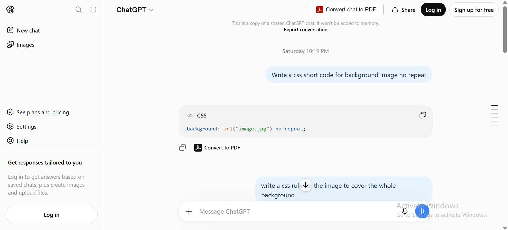

# JUNE SPORTS WEARS

### PLAY HARD, LOOK SHARP.

I developed JUNE SPORTS WEARS as part of the **UCD Professional Academy – Full Stack Software Development Diploma, Module 1: Web Design Assessment**.

- **GitHub Repository:** [View My Source Code](https://github.com/elomnnaemekaj/UCDPA-26_09-module_1_web_design-assessment)
- **GitHub Pages Live Website:** [Visit My Website](https://elomnnaemekaj.github.io/UCDPA-26_09-module_1_web_design-assessment/index.html)
- **AI Chat:** [View My AI-Assisted Development Conversation](https://chatgpt.com/share/6b0221c8-eacc-83ed-912d-9485f6c14237)

## Table of Contents

- [Project Overview](#project-overview)
- [Website Pages](#website-pages)
- [Technologies](#technologies)
- [HTML Structure and Semantic Elements](#html-structure-and-semantic-elements)
- [CSS Organisation and Styling Techniques](#css-organisation-and-styling-techniques)
- [Contact Table and Form](#contact-table-and-form)
- [Responsive Design](#responsive-design)
- [AI-Assisted Development](#ai-assisted-development)
- [Deployment and Version Control](#deployment-and-version-control)
- [Future Improvements](#future-improvements)

## Project Overview

I created JUNE SPORTS WEARS as a sportswear website concept for athletes, sports officials and sports enthusiasts. My aim was to present sportswear across different sporting activities while maintaining an inclusive approach to the intended audience.

I chose a black, green, green-yellow and white colour scheme to establish the visual identity of the brand. I used product imagery, icons, a consistent navigation header and a reusable footer to create a recognisable design across the website.

Through this project, I focused on presenting the brand, providing contact information and creating a basic account interface.

**My slogan:** PLAY HARD, LOOK SHARP.

## Website Pages

I organised my website into four main pages:

| Page | File | Purpose |
|---|---|---|
| Home | `index.html` | I use this page to introduce my brand and display sportswear categories. |
| About | `pages/about.html` | I use this page to explain my brand, mission, vision and promise. |
| Contact | `pages/contact.html` | I provide contact information, opening hours and a message form. |
| Account | `pages/account.html` | I provide a basic account login interface. |

## Technologies

I used the following technologies and tools to develop my website:

- **HTML5:** I used HTML to structure the content and elements of my website.
- **CSS3:** I used CSS to control layouts, colours, typography, spacing, backgrounds and responsive behaviour.
- **Bootstrap:** I used Bootstrap as an external framework and source of reusable styling resources.
- **Bootstrap Icons / SVG:** I used icons to support the visual presentation of interface elements.
- **Git and GitHub:** I used Git for version control and GitHub to manage my repository.
- **GitHub Pages:** I used GitHub Pages to publish my website online.

## HTML Structure and Semantic Elements

I used HTML5 semantic elements to organise my content and make my code easier to understand and maintain.

| Element | How I Used It |
|---|---|
| `<header>` | I used this element to contain my brand logo and navigation area. |
| `<nav>` | I used it to group my main navigation links. |
| `<main>` | I used it to contain the primary content of each page. |
| `<section>` | I used sections to separate related content into meaningful areas. |
| `<article>` | I used this element where content could be grouped as an independent or self-contained item. |
| `<aside>` | I used it for supporting information. |
| `<footer>` | I used it to contain my website footer and supporting links. |
| `<table>` | I used a table to present my opening-hours information. |
| `<form>` | I used a form to group the controls on my Contact page. |
| `<fieldset>` and `<legend>` | I used these elements to group related form controls and identify their purpose where appropriate. |

I included a document type declaration, language attribute, character encoding and viewport metadata in my HTML pages.

## CSS Organisation and Styling Techniques

I separated my CSS into external stylesheets to make my code easier to organise, maintain and update.

```text
assets/
└── css/
    ├── header.css
    ├── style.css
    ├── footer.css
    ├── about.css
    ├── contact.css
    └── account.css
```

I used `header.css` and `footer.css` for shared styling, while I used the remaining stylesheets to control the layouts of individual pages.

### 1. Universal Selector and Box Sizing

```css
* {
    margin: 0;
    padding: 0;
    box-sizing: border-box;
}
```

I used the universal selector (`*`) to target all elements. I removed the default browser margins and padding and applied `border-box` sizing.

This allows the declared width and height of an element to include its padding and borders, helping me manage element dimensions more consistently.

### 2. Class Selectors

A class selector starts with a full stop (`.`).

```css
.card-item {
    display: flex;
    flex-direction: column;
    align-items: center;
}
```

I used classes such as `.card-item`, `.logo`, `.link-item` and `.main-section` to apply reusable styles to elements.

A class can be assigned to multiple HTML elements, allowing me to apply the same styling to several product-category cards or other related components.

### 3. ID Selectors

An ID selector starts with a hash (`#`).

```css
#submit {
    background: green;
    color: white;
    border-radius: 10px;
}
```

I used an ID to identify a particular element, such as my contact form's Submit button.

IDs are useful when I need to target a unique element. I keep each ID unique within an HTML document.

### 4. HTML Tag Selectors

A tag selector targets elements by their HTML element name.

```css
header {
    display: flex;
    justify-content: space-between;
}

footer {
    display: flex;
    align-items: center;
}
```

I used tag selectors when I wanted to apply general styling to elements such as `<header>` and `<footer>`.

This allowed me to style matching HTML elements without assigning a separate class to each one.

### 5. Child Combinator

I used the `>` symbol to select a direct child of an element.

```css
.logo > h1 {
    color: white;
    font-size: 40px;
}
```

This selector targets an `<h1>` that is an immediate child of an element with the `logo` class.

I used the child combinator to target specific elements within a component without selecting every matching element nested further inside it.

### 6. First-Child Pseudo-Class

I used the `:first-child` pseudo-class to select an element when it is the first child of its parent.

```css
.btn-solid:first-child {
    border-radius: 10px 10px 0 0;
}
```

This selector targets an element with the `btn-solid` class when it appears as the first child of its parent.

I can use this technique to style the beginning of a group of adjacent controls differently from the other elements.

### 7. nth-child() Pseudo-Class

I used the `:nth-child()` pseudo-class to select an element according to its position among its siblings.

```css
.btn-solid:nth-child(3) {
    border-radius: 0 0 10px 10px;
}
```

This selector targets an element with the `btn-solid` class when it is the third child of its parent.

Unlike a class selector, `:nth-child()` allows me to apply styling based on an element's position. I can use it when I want different elements in a group to have different styles.

### 8. CSS Custom Properties

```css
:root {
    --brand-green: greenyellow;
    --white: #ffffff;
    --green: green;
    --backround: black;
}
```

I used CSS custom properties to store reusable values, such as colours.

I can access these values using the `var()` function:

```css
body {
    color: var(--backround);
    background: var(--white);
}
```

This approach helps me maintain a consistent colour scheme and update repeated values more efficiently.

### 9. Background Images and Overlays

```css
.main-section {
    background:
        linear-gradient(
            rgba(106, 103, 103, 0.75),
            rgba(147, 134, 134, 0.75)
        ),
        url("../images/09.jpg") no-repeat center center / cover;
}
```

I used a linear gradient to create a translucent overlay over my background image.

The `no-repeat` value prevents the image from repeating, while `cover` scales the image to fill the available area.

This technique helps me maintain the visual impact of the background image while keeping foreground content readable.

### 10. Flexbox and Media Queries

I used Flexbox to align and distribute elements within containers.

```css
display: flex;
justify-content: space-between;
align-items: center;
```

I used media queries to adjust my layouts at different screen widths.

```css
@media screen and (max-width: 650px) {
    /* Responsive styles */
}
```

This allows me to change element dimensions, direction and spacing to suit smaller devices.

## Contact Table and Form

### Opening-Hours Table

I used an HTML table on my Contact page to present opening-hours information.

I structured the table using:

- `<thead>` to contain my column headings.
- `<tbody>` to contain my data rows.
- `<tr>` to define each table row.
- `<th>` to define heading cells.
- `<td>` to define individual data cells.

I chose a table because opening days and times are related tabular information. This structure allows visitors to identify the opening hours for each day clearly.

### Contact Form

I created a contact form to provide visitors with a structured interface for entering their details and preparing a message.

My form includes:

- A text input for the visitor's name.
- An email input for the visitor's email address.
- A select control for the message subject.
- A textarea for the message.
- A Submit button.

I used the `required` attribute to provide basic browser-side validation for required fields. I also used `type="email"` to allow the browser to check whether the email input follows a recognised email format.

When a visitor clicks the Submit button, the browser attempts to submit the form. However, a working message-delivery feature requires a configured form endpoint or back-end service. The HTML interface alone does not send messages to me.

## Responsive Design

I used flexible layouts, percentage-based widths, Flexbox and CSS media queries to adapt my website to different screen sizes.

I included responsive styling for my navigation, homepage content, contact sections and footer.

My aim was to maintain a consistent and usable experience across desktop, tablet and mobile devices.

## AI-Assisted Development

I used AI tools as supplementary learning and development support during this project.

I sought assistance with understanding CSS properties, resolving styling questions and exploring possible implementation approaches. I reviewed the suggestions and incorporated them into my work where appropriate.

The screenshot below provides evidence of my AI-assisted discussion about CSS background image properties, including `background-repeat` and `background-size: cover`.

### AI Chat Screenshot



**AI conversation:**  
[View My AI-Assisted Development Conversation](https://chatgpt.com/share/6b0221c8-eacc-83ed-912d-9485f6c14237)

## Deployment and Version Control

I used Git and GitHub for version control and project management.

I made development changes in the `dev` branch, allowing me to review and refine updates before merging them into the `main` branch.

I use the `main` branch as the final production version of my project. This workflow allows me to keep development changes separate from the production version until they are ready to be integrated.

I published my website using GitHub Pages.

## Future Improvements

I identified the following features as possible future enhancements:

- Connecting my contact form to a message-handling service or back-end system.
- Implementing functional account registration and user authentication.
- Adding fully functional shopping-cart and search features.
- Expanding product information and introducing online purchasing functionality.
- Conducting further accessibility, browser compatibility and responsive testing.

I recognise these enhancements as opportunities for further development. However, they all fall beyond the scope of my current Module 1 Web Design Assessment.

I therefore focused my work on meeting the requirements and objectives of the assigned front-end website development task.

---

**JUNE SPORTS WEARS — PLAY HARD, LOOK SHARP.**
